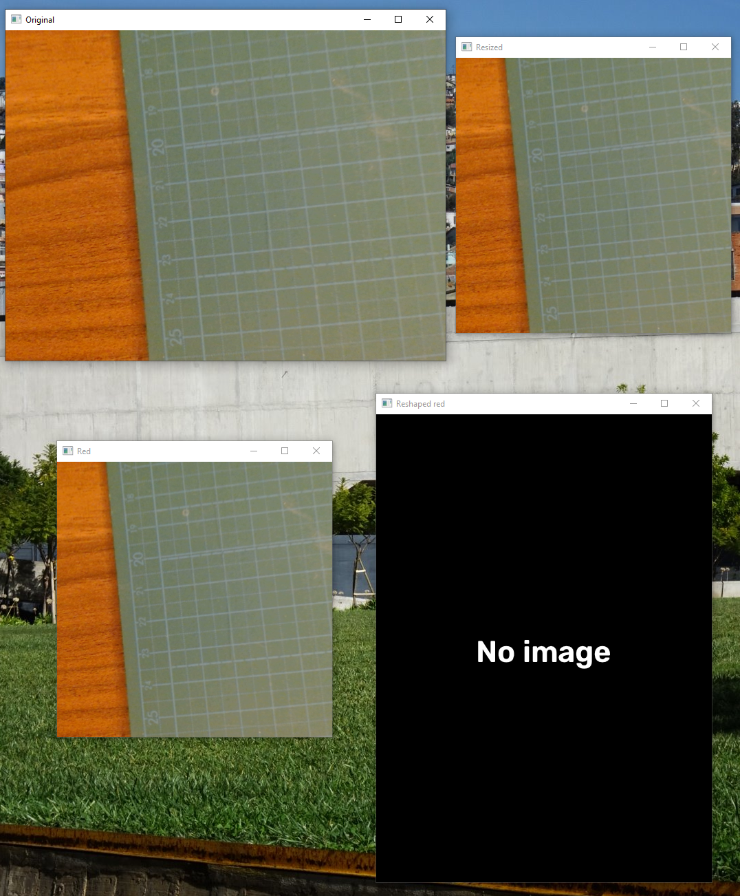

# MTG Card Corner Detection

# TODO

- [ ] Improve the training by adding a "fake sleeve" for better card detection.
- [ ] From the reshaped card, search the card information:
  - [ ] Mana cost, type, subtype, edition, foil information
  - [ ] Language (EN, JP, FR, ...)
  - [ ] Frame print version (old, new, full art, alternative)

## Preview

### Card detected


### No card detected



## Environment: WSL Ubuntu 24.04

The data is inside the repository, ignored by git (see `src/local_paths.py`):
- `scryfall/`: what `src/download.py` downloads (cards, images, symbols),
- `runs/`: what the trainings write (datasets, models), read by `src/webcam.py`.

### 1. Install the dependencies

```bash
python3 -m venv .venvwsl
source .venvwsl/bin/activate
python3 -m pip install --upgrade pip
pip install -r requirements.txt
```

---

## Train the card corner model (YOLO Pose)

```bash
source .venvwsl/bin/activate
python3 src/training_corner.py
```

This runs `train_yolo_pose(count=1000, frame="2015")` (end of `src/training_corner.py`), which:
- Picks 1000 card images of the 2015 frame, spread evenly over the expansions of `scryfall/exp/`, and downloads
  the missing ones
- Generates the dataset in `runs/yolo_pose_dataset/all_frame-2015/1000/`: each card in perspective on a noisy
  background, 400x400, labelled with its 4 corners (10% for the validation). A dataset that already has enough
  images is reused: delete its folder to generate it again
- Downloads `yolov8s-pose.pt` (~22 MB) from Ultralytics if it is not in the current folder
- Trains the model (400 epochs)
- Saves the best model in `runs/pose/card_corners/weights/best.pt` (replacing the previous one), read by
  `src/webcam.py`

Other cards or dataset size: change that call, ex:
`train_yolo_pose(count=2000, exp_code=["dsk", "blb"], frame=["2003", "2015"])`.

---

## Webcam inference

Connect the webcam to WSL first (see "Support video on WSL" below).

```bash
source .venvwsl/bin/activate
python3 src/webcam.py
```

# Study

The result with Yolo Pose is really good.
The trapezoid is well detected wherever the card are. The tilt of the card shouldn't exceed some degree but
I can improve this with a better dataset ok keep it that way. User will not tilt there card for fun on a scan process.

# Support video on WSL

In Powershell :

```Powershell
winget install --interactive --exact dorssel.usbipd-win
usbipd list                          # find your webcam's BUSID, e.g. 2-3
usbipd bind --busid 2-3              # once
usbipd attach --wsl --busid 2-3      # each time you start WSL
```

Then check in WSL :

```bash
sudo modprobe uvcvideo
ls /dev/video*                       # should show /dev/video0
sudo apt install v4l-utils
v4l2-ctl --list-devices
```
