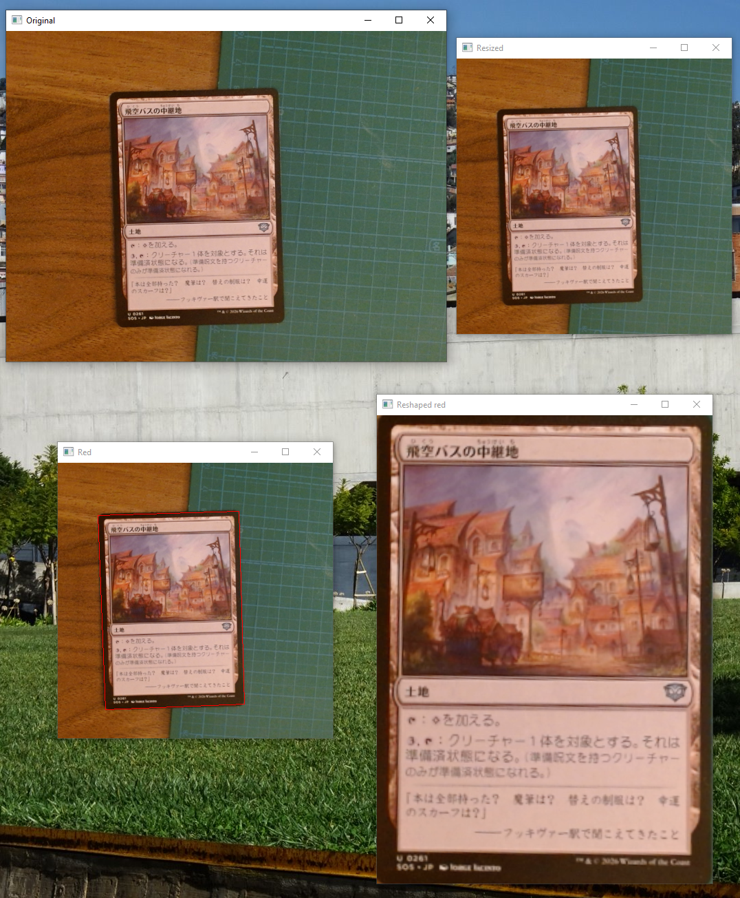
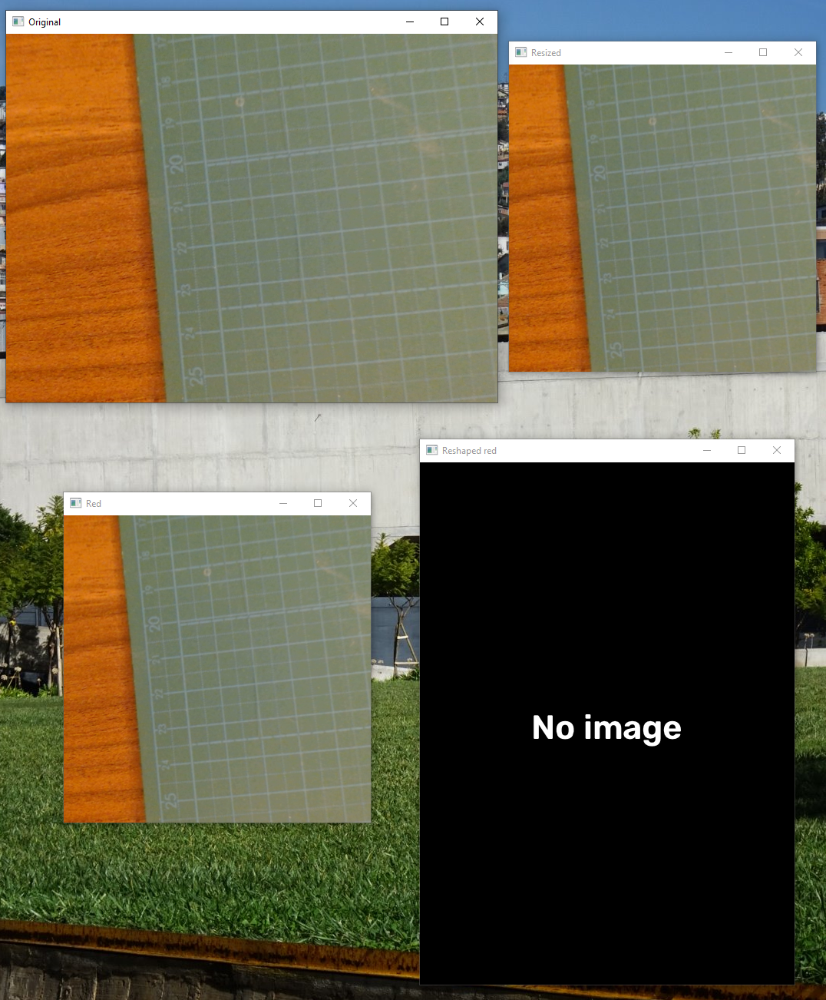

# MTG Card Corner Detection

# TODO

- [ ] Improve the training by adding a "fake sleeve" for better card detection.
- [ ] From the reshaped card, search the card information:
  - [ ] Mana cost, type, subtype, edition, foil information
  - [ ] Language (EN, JP, FR, ...)
  - [ ] Frame print version (old, new, full art, alternative)

## Preview

### Card detected



### No card detected



## Environnement : WSL Ubuntu 24.04

### 1. Installation des dépendances

```bash
python3 -m venv .venvwsl
source .venvwsl/bin/activate
python3 -m pip install --upgrade pip
pip install -r requirements.txt
```

---

## Entraîner le modèle YOLO Pose (model 5)

### 2. Configurer le modèle

Dans `src/algo_corner_detection.py`, ligne 20 :

```python
selection_model = 5
```

### 3. Lancer l'entraînement

```bash
source .venvwsl/bin/activate
python3 src/algo_corner_detection.py
```

Cela va automatiquement :
- Générer 2000 images synthétiques dans `yolo_pose_dataset/`
- Télécharger `yolov8s-pose.pt` (~22 MB) depuis Ultralytics
- Entraîner le modèle (50 epochs)
- Sauvegarder le meilleur modèle dans `runs/pose/card_corners/weights/best.pt`

---

## Entraîner les modèles Keras (model 0 à 4)

### 2. Configurer le modèle

Dans `src/algo_corner_detection.py`, ligne 20 :

```python
selection_model = 0  # ou 1, 2, 3, 4
```

### 3. Pré-générer le dataset (optionnel, recommandé)

```bash
source .venvwsl/bin/activate
python3 src/dataset.py
```

### 4. Lancer l'entraînement

```bash
source .venvwsl/bin/activate
python3 src/algo_corner_detection.py
```

---

## Inference webcam (Windows uniquement)

```Powershell
python -m venv .venvwin
.venvwin\Scripts\Activate.ps1
python -m pip install --upgrade pip
pip install -r requirements.txt
python src/webcam.py
```

> `selection_model` doit correspondre au modèle entraîné.

# Study

The result with Yolo Pose is really good.
The trapezoid is well detected wherever the card are. The tilt of the card shouldn't exceed some degree but
I can improve this with a better dataset ok keep it that way. User will not tilt there card for fun on a scan process.