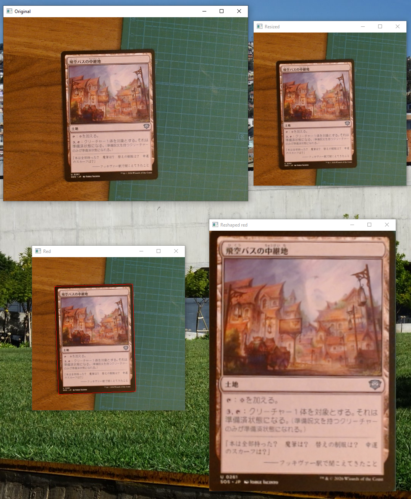

# MTG Card Corner Detection

# TODO

- [ ] Improve the training by adding a "fake sleeve" for better card detection.
- [ ] From the reshaped card, search the card information:
  - [ ] Mana cost, type, subtype, edition, foil information
  - [ ] Language (EN, JP, FR, ...)
  - [ ] Frame print version (old, new, full art, alternative)

## Preview

### Card detected



### No card detected


## Environment: WSL Ubuntu 24.04

The data is inside the repository, ignored by git (see `src/local_paths.py`):
- `scryfall/`: what `src/download.py` downloads (cards, images, symbols),
- `runs/`: what the trainings write (datasets, models), read by `src/webcam.py`.

### 1. Install the dependencies

```bash
python3 -m venv .venvwsl
source .venvwsl/bin/activate
python3 -m pip install --upgrade pip
pip install -r requirements.txt
```

---

## Train the YOLO Pose model (model 5)

### 2. Configure the model

In `src/algo_corner_detection.py`, line 20:

```python
selection_model = 5
```

### 3. Start the training

```bash
source .venvwsl/bin/activate
python3 src/algo_corner_detection.py
```

This automatically:
- Generates 2000 synthetic images in `runs/yolo_pose_dataset/`
- Downloads `yolov8s-pose.pt` (~22 MB) from Ultralytics
- Trains the model (50 epochs)
- Saves the best model in `runs/pose/card_corners/weights/best.pt`

---

## Train the Keras models (model 0 to 4)

### 2. Configure the model

In `src/algo_corner_detection.py`, line 20:

```python
selection_model = 0  # or 1, 2, 3, 4
```

### 3. Pre-generate the dataset (optional, recommended)

```bash
source .venvwsl/bin/activate
python3 src/dataset.py
```

### 4. Start the training

```bash
source .venvwsl/bin/activate
python3 src/training_corner.py
```

---

## Webcam inference

```Powershell
python -m venv .venvwin
.venvwin\Scripts\Activate.ps1
python -m pip install --upgrade pip
pip install -r requirements.txt
python src/webcam.py
```

> `selection_model` must match the trained model.

# Study

The result with Yolo Pose is really good.
The trapezoid is well detected wherever the card are. The tilt of the card shouldn't exceed some degree but
I can improve this with a better dataset ok keep it that way. User will not tilt there card for fun on a scan process.

# Support video on WSL

In Powershell :

```Powershell
winget install --interactive --exact dorssel.usbipd-win
usbipd list                          # find your webcam's BUSID, e.g. 2-3
usbipd bind --busid 2-3              # once
usbipd attach --wsl --busid 2-3      # each time you start WSL
```

Then check in WSL :

```bash
sudo modprobe uvcvideo
ls /dev/video*                       # should show /dev/video0
sudo apt install v4l-utils
v4l2-ctl --list-devices
```
